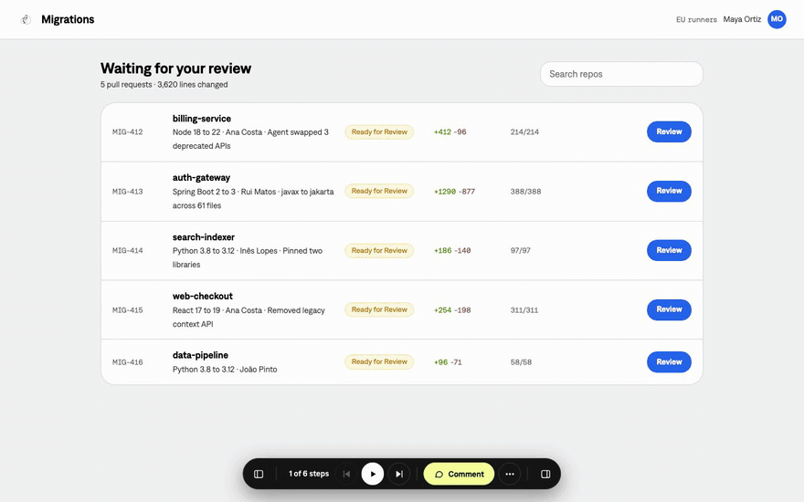
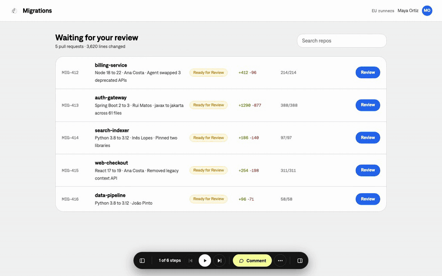
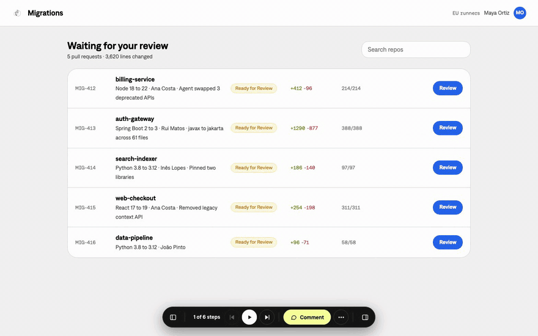
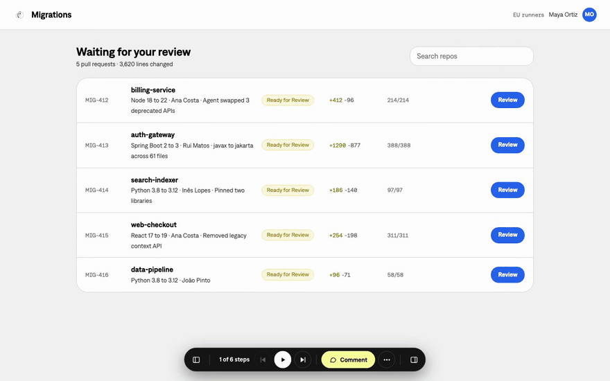
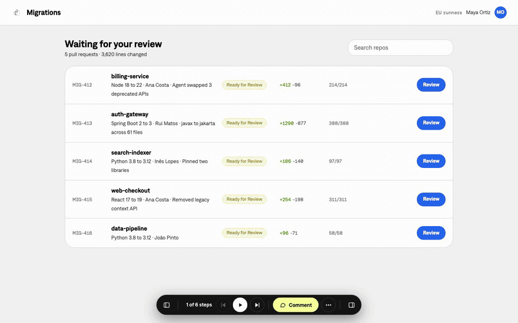
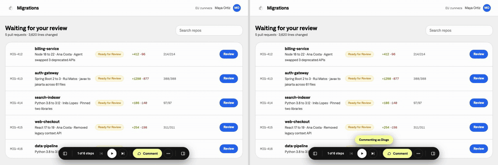

<p align="center">
  
</p>

<h1 align="center">Super Artifact Manager</h1>

<p align="center">
  <b>Agentic prototypes shouldn't be worse than Figma.</b><br>
  A Claude Code skill that gives any prototype, document or deck a player bar, journeys,<br>
  versions, a storyboard and live comments, on the real thing.
</p>

<p align="center">
  <a href="./LICENSE"></a>
  <a href="./artifact-manager/SKILL.md"></a>
  
  
  
  <a href="https://github.com/SupermodularAI/super-annotator"></a>
  
</p>

<p align="center">
  <a href="#what-it-does">Features</a> ·
  <a href="./artifact-manager/SKILL.md">Skill</a> ·
  <a href="./CONTRIBUTING.md">Contributing</a>
</p>

<p align="center">
  <a href="https://www.supermodular.ai">
    <picture>
      <source media="(prefers-color-scheme: dark)" srcset="./media/brand/logotype-dark.svg">
      
    </picture>
  </a>
</p>

<p align="center"></p>

Your agent builds a working prototype in a day. Then it gets shared as a localhost
link, one happy path, feedback in Slack. Super Artifact Manager keeps what Figma got
right (a link, comments in context, versions, flows, presenting, the canvas) and adds
what Figma never could, because its prototypes were never real.

Same goes for the specs and decks your agent writes: pages and slides you can step
through, versions side by side, and comments pinned to the exact words.

It's not a product. No SaaS, no account. It's a skill: you ask your agent to add it, and
when your team has a new idea, you ask your agent to build it in.

## What it does

**Prototypes**

- **Journeys.** Who you are (role), what state the data is in (a mock data set), which
  feature flags are on, what fails, how the network behaves. One `journeys.json` per
  prototype, a searchable picker, links that carry the journey.
- **Real failures, on demand.** Name a failure once ("Merge blocked by CI") and the
  panel answers the prototype's real `fetch` / XHR calls with a 409, a timeout, an
  empty list or a network error.
- **Play.** A simulated cursor walks the journey in the real prototype and really
  clicks, types and selects. Previous and next step through it. `⌘\` hides every
  control for presenting.
- **Storyboard.** Every step as its own live screen on a canvas, for one journey or all
  of them at once, with arrows where journeys branch. Pan, zoom, click a screen to open
  that step, comment on it.
- **Parameters.** Built from `journeys.json`, not a generic form: role, data, region,
  flags, errors, latency, network, plus anything your agent adds for this prototype.

**Documents and presentations**

- **Pages and slides.** Set `"type": "document"` or `"presentation"` and the bar pages
  through it ("Page 3 of 12", "Slide 3 of 12"). Decks show one slide at a time, like a
  presentation. Documents can be paginated (A4 pages on a canvas) or one continuous
  page, stepped by section.
- **Storyboard.** Every page or slide side by side on the canvas.

**Everything**

- **Versions.** Open any earlier version, or compare two side by side, in step. Each
  version has a status (Draft, Open for review, Changes requested, Approved, Closed)
  that reviewers can change from the drawer. Closed versions take no new comments.
- **Devices.** Responsive, laptop, tablets, phones, Android or a custom size, without a
  reload.
- **Comments.** Powered by [Super Annotator](https://github.com/SupermodularAI/super-annotator),
  single-player or live multiplayer.
  - Click to drop a pin where you clicked, drag to comment on an area, or select words
    to quote them.
  - Element and area comments carry a small picture of what they point at.
  - Every comment knows where it was left: version, journey and step, or page, section
    and slide, plus the element. Your agent knows exactly what to change.
  - Read them in a sidebar or as cards floating next to their pins. Filter, sort,
    resolve, archive, and copy a link that opens the exact comment.
  - **Agents comment too.** Claude Code (or any script) leaves comments with
    `bin/comment.js` or `SMAnnotate.add()`, pointing at the same things a person
    can, with links to the docs behind each suggestion. They show with the agent's
    avatar and an Agent badge.

  
- **Share.** Copy the link, copy or export comments as Markdown, or export a journey
  (or all of them) as an MP4 with no controls in the shot.
- **Gate.** Optional: no password, a shared password, or Sign in with Microsoft
  (Entra ID). It runs before anything is served, mock data included.

| | |
|---|---|
|  |  |
|  |  |

## Try it

```bash
git clone https://github.com/SupermodularAI/super-artifact-manager.git
cd super-artifact-manager/artifact-manager
npm run demo
# open http://localhost:4630/artifact-manager/examples/
```

Every example is a mock product with fictional data:

- `examples/migrations/`: an agent opens framework-upgrade pull requests across a fleet
  of repos and a reviewer merges them.
- `examples/expenses/`: an expense-approval app (also at `examples/prototype/`).
- `examples/document/`: a paginated A4 spec.
- `examples/document-continuous/`: a policy written as one long page.
- `examples/presentation/`: a quarterly review deck.

Each one has four versions and a thread of comments from people and Claude Code.

## Add it to your project

Copy `artifact-manager/` (and `annotate/` next to it, for comments) into your
project's `.claude/skills/`, then ask your agent:

> Add Super Artifact Manager to this prototype. Write journeys for each role, an empty
> state, a heavy data set and every failure the product has to handle.

Or, for a spec or a deck:

> Add Super Artifact Manager to this document, with comments and both versions.

It reads [`artifact-manager/SKILL.md`](./artifact-manager/SKILL.md), asks how it
should be accessed, runs `bin/add.js`, writes the config and mocks, and checks every
journey once.

By hand:

```bash
node artifact-manager/bin/add.js path/to/prototype --gate password --name "My prototype"
```

For a document or a deck, set `"type": "document"` or `"type": "presentation"` in the
config it writes.

Live comments need a relay you run yourself (Node or your own Cloudflare account). See
[Super Annotator](https://github.com/SupermodularAI/super-annotator) and set
`"comments": { "live": true, "url": "wss://<your-relay>/sync" }` in the config.

## Tests

```bash
cd artifact-manager
npm install
npm test                                              # unit + gate
npx playwright test --config playwright.config.cjs    # end to end
```

## License

Apache 2.0. Made by [supermodular.ai](https://supermodular.ai).
